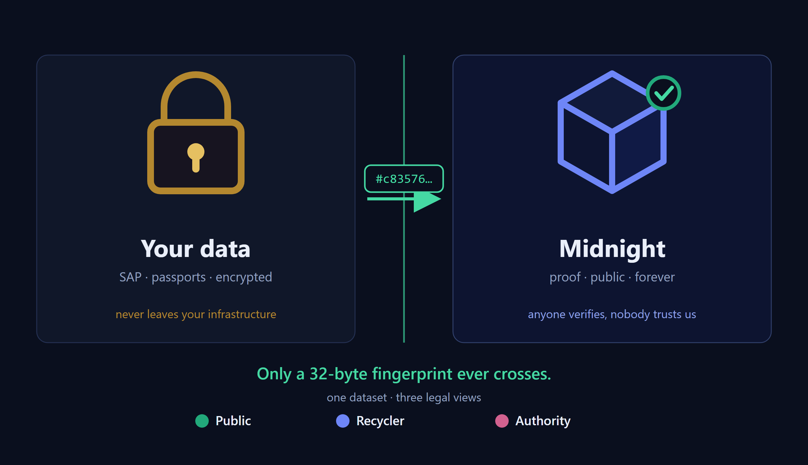
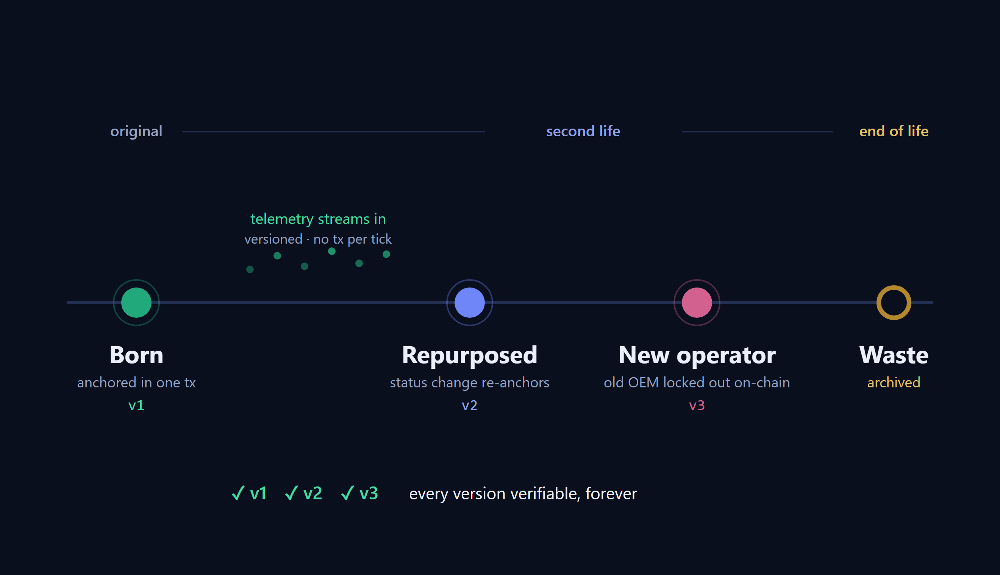

# NIGHTPASS: Architecture

> Digital Product Passport with selective disclosure on Midnight
> (zero-knowledge), for two product families: the EU Battery Regulation
> 2023/1542 battery passport and the component passport for safety-related
> parts of regulated plants. NIGHTPASS (`@odatano/passport`) is the consumer
> application: it builds passports, anchors their integrity hash and a
> field-commitment root on-chain, and serves three lawful disclosure levels
> from one backend.



Six sections: the layering, the data flow, the security model, the field-bound
predicate, the product profiles, and how a consumer pulls the platform in as a
CAP plugin.

## 1. Three layers

The system is split into layers that are owned independently. That split is the
product thesis: the chain integration is reusable across any product passport,
not just batteries.

| Layer | Package | Owns |
|---|---|---|
| Platform | `@odatano/nightgate` | The Midnight read/write bridge: OData services, indexer, wallet/proof submission, job tracking. Shipped as a CAP plugin. |
| SDK surface | `@odatano/nightgate` (sub-path exports) | The reusable on-chain primitive, the `attestation-vault` Compact contract, the CDS schema (`midnight.*`), the submission actions, and the browser building blocks (`@odatano/nightgate/browser`). |
| App | `@odatano/passport` | The product-family schema (battery, component) on top of `@odatano/dpp-sdk` profiles, the producer cockpit and consumer viewer, the disclosure gating, the QR resolver, the off-chain content-root Merkle builder. This repo. |

The app never reaches into the plugin's internals. It configures the plugin via
`cds.requires.nightgate` and calls it over the documented OData surface
(`/api/v1/nightgate`) and the browser building blocks. A capability the app needs
but the platform lacks becomes a feature request against NIGHTGATE, never a local
patch. That is what keeps the platform reusable.

The `attestation-vault` contract is shipped by the plugin and consumed as-is.
There is no contract in this repo (the earlier separate `passport-attestation`
contract was folded into `attestation-vault`).

## 2. Data flow

Two write surfaces, one contract, one read surface.

**Write (producer):** the producer cockpit (`app/producer/webapp`, `ProducerService`)
creates a passport from the family's head fields and detail rows (for a battery
the Annex XIII fields), computes the `blake2b-256` payload hash,
AES-encrypts the payload off-chain, and anchors it on-chain. Anchoring runs three
circuits, batched into ONE transaction with deterministic apply order:
`attest` (creates the record `recordKey(attesterId, payloadHash)`; since vault
lineage 4 every record is keyed by the attester AND the payload, so no other
caller can pre-empt, block or take over it), `anchorContentRoot` (pins the
Merkle root over the provable fields plus its schema id), and `bindDocument`
(binds `passportIdHash -> record` for QR resolution; last, because it is the
fallible call). A registrar (the vault deployer) can pre-register a
`passportId` to an attester identity, so a registered id can only ever be
bound by its owner; a recovery identity named at deploy can re-point the
registrar. The row stores the anchoring `attesterId`: every state read and
every claim key names the record by it. Disclosure grants and predicate proofs
are further circuit calls; the attester can `retract` its record.

**Two ways to submit,** same contract, differ only in who holds the key:

1. Server path: `ProducerService` runs the calls through NIGHTGATE's worker wallet
   as async jobs (no UI, no wallet popups), polling `getJobStatus`.
2. Wallet path: the cockpit runs the same calls in-app from the user's Lace wallet
   over the DApp-Connector, using `@odatano/nightgate/browser`.

Offline-first: without a signing session or contract, actions write local tracking
rows so the cockpit and read gate work without the chain.

**Read (consumer):** `PassportService` reads the same data back for the viewer at
three tiers. An `after READ Passports` handler redacts restricted fields per tier.
The QR resolver (`GET /p/:passportId`) picks the tier from the caller's auth and
redirects into the right route.

Only the payload hash, the `passportId` binding, the content root, disclosure
commitments and predicate results ever reach the chain. The payload never does.

**Dynamic data ingest (post-market updates, battery family).** After the battery is placed on the
market, its dynamic SoH attributes (capacity fade, remaining capacity, cycle
counts, and the other Performance-and-Durability telemetry rows) keep changing.
A BMS or telemetry source pushes updates to `POST /api/v1/passport/telemetry`,
which runs `ProducerService.updateDynamicAttributes`. Machine auth is an HMAC
over `<x-bms-timestamp>.<raw body>` via `TELEMETRY_WEBHOOK_SECRET`, sent as
`x-bms-signature`. Signing the timestamp alongside the body is what makes the
frame replay-proof: the server rejects a stamp outside a five-minute window and
remembers each signature for that span, so a captured frame can be replayed
neither later nor immediately. Unlike the ERP webhook, which is idempotent on
`passportId`, every telemetry frame legitimately appends a new attribute
version, so a replay would age the battery a second time and push the row into
anchor drift.
The action accepts RAW values, encodes them into the exact guide shapes
(`srv/lib/attribute-update.ts`; note the validator requires integer values for
the ampere-hour and Celsius attributes), updates the current
`PassportAttributes` rows in place and appends to the append-only
`PassportAttributeHistory` (version 0 is a lazy baseline of the creation-time
value). Only an allowlist of dynamic attributes is updatable; access classes
never change through this path, so the tier gate applies unchanged and the
recycler view reflects updates immediately. The DPP Life Cycle API's
`dppsByProductIdAndDate` reconstructs the document as of any date from that
history. A deterministic BMS simulator stands in for a real feed
(`srv/lib/bms-simulator.ts`, `BmsSimulatorService.triggerBmsTelemetry`,
`scripts/zz-bms-simulate.mts`).



**Re-anchoring policy (anchor versions).** Which changes force a new on-chain
anchor:

| Change | Anchor consequence |
|---|---|
| Telemetry tick (updateDynamicAttributes) | none; accumulates as drift |
| Accumulated telemetry | periodic batch re-anchor (`scripts/zz-reanchor-batch.mts`, operator or cron; no built-in timer, so no unattended chain spend) |
| Lifecycle / status change, data corrections to batteries or recycled materials | re-anchor required (same action) |
| Point-1 fields (model, weight, ...) | never in the hash; no re-anchor |
| Diligence upload | own anchorDocument tx as before; from projection v2 on, the next re-anchor also binds the file sha256 into the payload hash |

`ProducerService.reanchorPassport` recomputes the payload from the CURRENT
database state (projection v2, `srv/lib/passport-payload.ts`: versioned
`payloadVersion: 2` marker, normalized numerics, stable ordering), archives the
current anchor as a `PassportAnchorVersions` row (including its cipher), and
runs the standard anchor flow: attest of the new hash, a fresh content root,
and the `bindDocument` RE-BIND of the same passportIdHash (the vault allows a
rebind by the registered owner, or by the owner of the currently bound record
for unregistered ids), as ONE transaction. The re-anchor must run with the
same wallet that holds the current binding; the archived version keeps its
own `attesterId`, so it stays verifiable and comparable after a handover.

**Version transitions (NIGHTGATE 0.16.0 cross-root proofs).** A re-anchor alone
does not say WHAT changed: each version carries its own payload hash and its
own salted content root, so from outside the two anchors look unrelated.
`ProducerService.proveVersionIntegrity` closes that gap with
`proveDocumentComparison`, which witnesses both versions' openings plus the
shared schema, recomputes both content roots in-circuit and asserts them
against the anchors. Values stay hidden; every statement is per-slot
"changed / unchanged", never a value.

Two complementary bounds, provable in ONE transaction:

| Bound | Mode | Statement |
|---|---|---|
| Upper (`allowedFieldsJson`) | integrity | nothing outside the named fields changed; the empty list is the strongest form, "no provable field changed at all" |
| Lower (`minChangedSlots`, k) | diff | at least k of the 16 slots DID change |

Alone, each is weak. The upper bound is also satisfied by a re-anchor that
measured nothing; the lower bound is satisfied by noise. Together they pin a
transition from both sides, which is what the regulation's "keep the dynamic
data current" duty needs: **the specification is untouched AND the measured
values really moved**, so a genuine re-measurement is distinguishable from a
re-timestamp of unchanged numbers. That is why the measured fields
(`CapacityFade`, `RemainingCapacity`,
`NumberOfFullChargingAndDischargingCycles`) sit in the provable panel at all.

Anyone re-checks both crawler-free and without a wallet:
`PassportService.verifyVersionIntegrityOnChain(passportId, payloadHashA,
payloadHashB, allowedMask)` and
`verifyVersionChangeOnChain(passportId, payloadHashA, payloadHashB,
minChangedSlots)`.

Honest limits: k counts slots, not magnitudes, so a change in the third
decimal counts like a halving; and under the circuit's absence policy a field
present in one version and absent in the other counts as changed, so the
lower bound is only meaningful together with the upper bound that fixes which
slots may move at all. Both proofs need BOTH versions' openings, so only a
party holding both documents can prove; the counterparty verifies the
statement, not the data.

Old versions stay verifiable forever: the vault never forgets an attested
hash. `PassportService.anchorHistory` lists all versions,
`verifyAnchorVersion(passportId, version)` live-verifies a superseded one, and
the explorer detail page shows the version list with per-version verify.
On-chain artifacts are per version: disclosure grants do not carry over to a
new version (reanchorPassport returns `grantsToRegrant`; local grant-log
elevation keeps working), and ZK claims verify against the payload hash they
were proven under (stamped on `PredicateProofLog.payloadHash`).

**Battery lifecycle and operator handover.** The battery status (Annex XIII
4(c): original, repurposed, reused, remanufactured, waste) lives in the
BatteryStatus attribute row; `changeBatteryStatus` is its only write path
(transition matrix in `srv/lib/battery-lifecycle.ts`), versions it in the
attribute history and re-anchors anchored passports immediately (a status
change is a substantive change). The DPP document's `DPPStatus` derives from
it: waste reads as Archived, everything else as Active. For Second Life,
`transferPassportOperator` hands the passport to another operator wallet: the
registrar (the vault deployer's wallet, `PASSPORT_REGISTRAR_WALLET`)
re-registers the passportIdHash to the new operator's attester identity, and
on chain success the `Passports.owner` scope flips. From then on only the new
operator can re-bind the id (in-circuit `not passport owner` for everyone
else, including the registrar) and only the new operator passes the
server-side owner guard; disclosure grants are re-issued by the new operator
after their first re-anchor, since grants are per payload version anyway.

## 3. Security model

Four mechanisms, each guarding a different boundary.

**Off-chain confidentiality.** The full payload (chemistry, capacity, supplier
identities, carbon footprint, diligence evidence) is encrypted with AES-256-GCM
under a per-passport key derived via HKDF-SHA256 from the app secret
(`ENCRYPTION_KEY`) salted with `passportId`. Ciphertext layout is
`iv(12) || authTag(16) || ciphertext`. The on-chain hash lets anyone verify
integrity; only a key-holder can decrypt.

**Disclosure levels: the API is the boundary.** Disclosure is enforced
server-side in `srv/passport-service.ts`, not on the chain, by `after READ`
handlers that strip fields per level. The vocabulary (`public` <
`legitimateInterest` < `authority`) and the redaction rules per product profile
come from `@odatano/dpp-sdk`; the app maps its roles onto the levels:

- public (anonymous): the head fields plus QR URL. Battery: Annex XIII Point 1.
- legitimateInterest (role `recycler`): plus the profile's children minus
  supplier identities. Battery: cell chemistry, capacity, recycled-content
  shares. Component: material certificates and qualification tests.
- authority (superset): everything, including supplier identities, carbon
  footprint, diligence docs, inspector ids, the chain of custody, and on-chain
  lineage.

The gating runs on the service projections, so it cannot be bypassed by a crafted
`$expand` or a direct entity read. The client UI mirrors the level for presentation
only; it is never the boundary.

**On-chain tier entitlement.** The `attestation-vault` `disclosures` ACL
(`grantDisclosure` / `revokeDisclosure`, levels 0/1/2) is a tamper-evident,
revocable registry. NIGHTGATE indexes it into `midnight.DisclosureGrants` and binds
principals to grantee ids via `midnight.GranteeIdentities`. `effectiveGrantsFor`
in the read gate consults it (union with the offline `DisclosureGrantLog`): an
active grant elevates a requester's tier above their login role, scoped per
passport (by `payloadHash`), and degrades to the login role on any lookup failure.

**Integrity and authorization: ZK proofs, not signatures.** On-chain writes go
through Midnight circuits authorized by zero-knowledge proofs. Owner-gated
circuits (`grantDisclosure`, `bindDocument`, `anchorContentRoot`, `retract`)
derive the record key from the caller's own identity, so authorization holds
without revealing key material or the payload. The proof circuits are open to
any holder of the opening and carry an expiry (`valid_until`, at most five
years, extend-only), so a claim outlives neither the record nor its lifetime.

## 4. Field-bound predicates

A reveal-or-hide credential cannot prove "the value is below the limit" without
showing the value. NIGHTPASS proves exactly that, and binds the proven value to the
passport's actual field so a verifier knows it came from this passport.

- At attest time the producer builds a depth-4 Merkle tree over the passport's
  provable fields and anchors its root plus a SCHEMA ID with
  `anchorContentRoot(payloadHash, contentRoot, schemaId)`. The schema id is the
  root over the 16 slot descriptors (field key, kind, scale); it binds how a
  slot is to be read, so the same leaf value under a different scale is a
  different schema and cannot be compared across versions.
- Leaves are SALTED (NIGHTGATE 0.16.0): each leaf carries
  `slotSalt(seed, slotIndex)` from a per-version 32-byte seed, absent slots
  included. That matters here because inclusion paths are handed to the
  browser: a sibling on the leaf level is a neighbouring field's leaf hash,
  whose field key is publicly derivable and whose value domain is small, so
  unsalted leaves were guessable. The seed is the anchor's OPENING: it is
  stored server-side (`Passports.contentSaltSeed`, archived per version),
  excluded from every service projection, and never published. Losing it makes
  the anchored root unprovable; publishing it undoes the salting.
- The off-chain tree is built with the contract's exported `pureCircuits`
  (`leafHash` / `bytesLeafHash` / `absentLeafHash` / `nodeHash` /
  `descriptorLeafHash` / `slotSalt`), so root and schema id are byte-identical
  to the in-circuit recompute. Builder: `srv/lib/passport-anchor.ts`
  (`buildContentRoot(profile, values)` over the profile's panel), pinned
  against NIGHTGATE's own document-proof builder by a parity test.
- `proveFieldPredicate(payloadHash, fieldKey, threshold, op)` recomputes the field
  leaf from witnessed value plus inclusion path, folds it to a root, asserts the
  root equals the anchored content root, then asserts the predicate. The tx only
  lands if both hold, so a successful tx is the proof. The value stays a witness.
- Set membership on STRING fields (NIGHTGATE 0.15.0): a hidden value is proven
  to be ONE of a public allow-list of up to 64 values without revealing which.
  String leaves enter the content tree as `bytesLeafHash(fieldKey,
  blake2b256(exact string))`; `proveFieldMembership(payloadHash, fieldKey,
  setRoot)` folds the witnessed digest into BOTH the anchored content root and
  the canonical allow-list tree (digest, dedupe, sort, pad to 64 with the last
  member, `setLeafHash` leaves, depth 6). The allow-list itself is published
  with the claim, so any verifier recomputes the set root from the list alone.
  The app catalog (`srv/lib/claim-sets.ts`) collects every family's named
  lists from `@odatano/dpp-sdk` (battery: the recognized chemistries;
  component: approved grades, austenitic grades, qualified suppliers, approved
  NDT methods). The fields are legitimate-interest or authority level, so the
  claim discloses membership, never the value. Local root builder:
  `srv/lib/membership-set.ts`, pinned to the platform implementation by a
  golden-vector test.
- Cross-root claims relate TWO anchored versions instead of one field:
  version integrity (see section 2) and, available from the platform but not
  yet surfaced here, distinctness ("at least k of the 16 slots differ", the
  "provably not the same document" claim).
- Claims batch: up to 8 claims in ONE transaction, numeric and membership
  kinds mixed freely (browser `proveFieldPredicateBatch`, one approval; server
  `provePassportValuesBatch`; both share one pure claim plan). A false claim
  aborts the batch at local proving, nothing lands; after submit every claim
  is verified individually.

Provable fields per family. Battery: carbon footprint, capacity, recycled
content (overall and per material for cobalt / lithium / nickel), cycle life,
round-trip efficiency, lead content, and cell chemistry (membership).
Component: yield strength, tensile strength, hardness, cobalt content, wall
thickness, and material grade, supplier id and test method (membership). Each
numeric field pairs with a regulatory or buyer-relevant bound (for example
recycled cobalt at least the Article 8 minimum, or cobalt content at most a
contamination limit).

Honest limitation: the content root corresponds to the payload hash because the
same attester builds both from the same canonical content at anchor time. A fully
trustless binding would need in-circuit blake2b, which is impractical. The gain is
real: after hardening, a producer cannot prove a value unrelated to the anchored
fields, cannot show different values to different verifiers, and cannot change a
value without re-anchoring (and a new payload hash).

## 5. Product profiles

A profile is one product family. It binds a `ProductProfile` from
`@odatano/dpp-sdk` (payload children with their columns, sort order and access
rules; the provable fields and where each is sourced) to the app's own child
tables and membership catalog (`srv/lib/product-profiles.ts`, `APP_PROFILES`).

| Family | dpp-sdk profile | Child tables | Claim sets |
|---|---|---|---|
| `battery` | `BATTERY_PROFILE` | `Batteries`, `RecycledMaterials`, `DiligenceDoc` | `BATTERY_CLAIM_SETS` |
| `component` | `COMPONENT_PROFILE` | `MaterialCertificates`, `QualificationTests`, `CustodyRecords` | `COMPONENT_CLAIM_SETS` |

- **`Passports.profile`** names the family of a row (default `battery`; rows
  from before the column existed are batteries). A passport fills the children
  of its profile; the others stay empty. Every family shares the head columns
  (`passportId`, `model`, `manufacturerId`, `weightKg`, ...) and the attribute
  rows; the component family keeps its safety class and status as public
  attribute rows.
- **Payload**: `projectPayload(profile, rows)` builds the canonical payload
  from the profile's children plus the attribute rows; the hash, cipher and
  wire format do not depend on the family.
- **Content tree**: the profile's panel (`panelOf(profile)`) is the ordered
  slot list of the Merkle tree, so the schema id is per family and a claim on
  one family's field cannot be read against another's. The battery panel and
  the component panel each fit the 16-slot tree.
- **Redaction**: `redactRow(profile, row, level)` strips the head row;
  `redactChildRow(spec, row, level)` strips each child per its spec
  (`minLevel`, for the chain of custody `authority`; `authorityColumns`, for
  supplier and inspector identities). The service registers one `before` and
  one `after READ` handler per child entity of every family.
- **Membership catalog**: `ALL_CLAIM_SETS` unions the families' allow-lists;
  set ids are unique across families, so a claim's `setId` identifies the
  list without the family.
- **Demo catalog** (`srv/lib/demo-claims.ts`): per family the public head
  fields, the provable values with their directions and bounds, the primary
  claim and whether a second-life act exists. `demoProfiles()` and
  `demoClaimFields(profile)` serve it to the "Try it" page.

The producer cockpit, the BMS simulator, the DPP Life Cycle API and the
Catena-X export serve the battery family.

## 6. Build and deploy: the platform as a CAP plugin

A consumer app needs no glue code. CAP discovers the plugin and merges its CDS.

**1. Depend on the plugin.**

```bash
npm install @odatano/nightgate @cap-js/sqlite
```

**2. Configure it** in `package.json` under `cds.requires.nightgate`. The contract
points at the artifact shipped inside the installed plugin:

```jsonc
{
  "cds": { "requires": {
    "db": { "kind": "sqlite" },
    "nightgate": {
      "network": "preprod",
      "granteeBinding": "did",
      "crawler": { "enabled": false },
      "contracts": {
        "attestation-vault": {
          "artifactPath": "node_modules/@odatano/nightgate/contracts/attestation-vault/src/managed/attestation-vault/contract/index.js",
          "privateStateId": "attestationVaultPrivateState",
          "zkConfigPath": "node_modules/@odatano/nightgate/contracts/attestation-vault/src/managed/attestation-vault"
        }
      }
    },
    "auth": { "kind": "custom", "impl": "srv/auth.js" }
  } }
}
```

**3. Deploy and run.**

```bash
npm run deploy   # creates the midnight_* tables + the passport schema
npm start        # cds-tsx serve: REQUIRED for the TypeScript service impls
```

> `cds-tsx serve`, not `cds serve`. Plain `cds serve` has no TS loader and silently
> skips `srv/*.ts`, falling back to a generic CRUD handler, so no tier gating and no
> producer actions. The boot log is the tell: `impl: 'srv/passport-service.ts'`
> (good) vs a generic `...-service.js` (impl not loaded).

On boot the services mount side by side and the boot log confirms
`Registered contracts: counter, attestation-vault`.

Live on-chain writes additionally need a funded wallet and a proof server. The
server path needs a signing session and `PASSPORT_CONTRACT_ADDRESS`; the wallet path
needs Lace and a local proof server at `http://localhost:6300`. Without them the
offline path (hash, encrypt, persist, QR, local log rows) still runs.

### At a glance

- Services: `ProducerService` (`/api/v1/producer`), `PassportService` (`/api/v1/passport`), `NightgateService` (`/api/v1/nightgate`), `DemoService` (`/api/v1/demo`, only with `DEMO_ENABLED=true`).
- Families: `battery` and `component`, one `Passports.profile` per row, profiles from `@odatano/dpp-sdk`.
- Contract: one `attestation-vault` (plugin-shipped): tiered disclosure, passport binding, numeric predicate, and field-bound predicate.
- Crypto: blake2b-256 integrity hash, AES-256-GCM + HKDF-SHA256 payload encryption, salted Merkle content root (the contract's transient hash), ZK-proof authorization.
- UI: producer cockpit (battery, with in-app Lace wallet flow), consumer viewer (three disclosure levels), public explorer, "Try it" demo, QR resolver at `/p/:passportId`.
- Chain: Midnight (preprod): public metadata, hash, binding, content root, disclosure and predicate results only.
